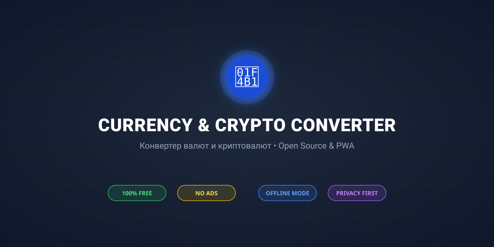
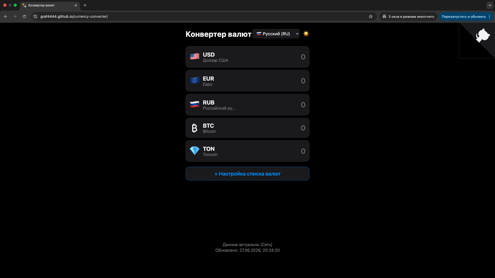
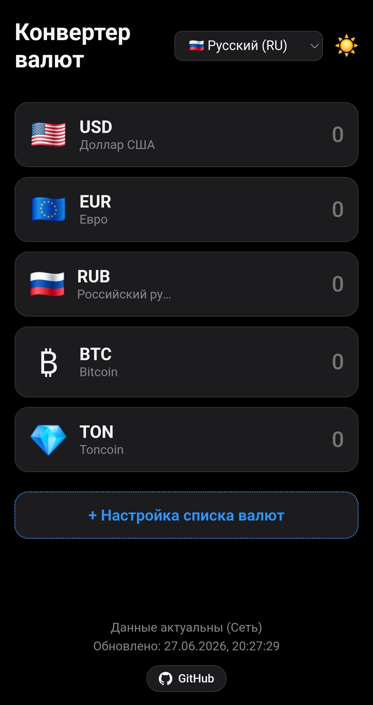

# 💱 Currency & Cryptocurrency Converter / Конвертер валют и криптовалют

<p align="center">
  
</p>

<div align="center">

### 🌐 Select Language / Выберите язык документации:
[](#english)
[](#russian)
[](CHANGELOG.md)

---

### 🚀 **[graf4444.github.io/currency-converter](https://graf4444.github.io/currency-converter/)**
**Free live web application — ready to use in any browser with no installation!**  
*Бесплатное веб-приложение готово к использованию прямо в браузере без установки.*

<p align="center">
  <a href="https://graf4444.github.io/currency-converter/"></a>
  
  
  
</p>

<p align="center">
  
  <br>
  <sub>🛡️ <i>Total visits / Счётчик просмотров (<a href="https://www.goatcounter.com" target="_blank" rel="noopener noreferrer">GoatCounter</a>: privacy-friendly, no cookies / без cookie и сбора данных)</i></sub>
</p>

</div>

---

<a id="english"></a>
## 🇬🇧 English

> 🇷🇺 **Ищете описание на русском языке?** [Перейти к русской версии](#russian)

A modern, fast, and lightweight **Open Source** web tool for converting world currencies and popular cryptocurrencies. It works instantly as a regular website in any browser, but can also be installed as a full-featured application on any device (iOS, Android, Windows, macOS) — with no app stores required.

⭐ **If you like this project, please support it by giving it a star! It motivates me to add new features.**

---

### 🚀 Live Web Application

> 💡 Open the application directly in your browser:  
> 👉 **[graf4444.github.io/currency-converter](https://graf4444.github.io/currency-converter/)**  
> *Free, no registration, no ads, works on any smartphone, tablet, or desktop.*

<p align="center">
  <b>💻 Desktop Version</b><br>
  <br><br>
  <b>📱 Mobile Version</b><br>
  
</p>

---

### ✨ Key Features
* **🎯 True Multi-Platform:** Use it as a website or install it directly onto your smartphone, tablet, or PC home screen as a standalone app (PWA).
* **⚡ PWA Quick Actions (App Shortcuts):** Long-press the app icon on Android or right-click on Desktop/macOS to access quick actions: instant conversion (USD → EUR, USD → RUB), quick calculator keypad, and instant currency search.
* **🔒 Smart Express Mode:** Dedicated 2-currency quick conversion without scrambling your saved favorites. Changing theme and language persists, while a clean "Show All Currencies" button or back gesture smoothly returns to the full list.
* **📤 Share Calculation (Share Breakdown):** One-tap button next to inputs and inside the calculator keypad exports a beautifully styled exchange summary with country flags, calculation date and time, and an interactive direct link to the app (via clipboard or native system share dialog).
* **📋 Smart Clipboard Paste & Privacy:** Automatically detects copied amounts and currency symbols (e.g. `120$`, `49.99 EUR`, `5000 руб`, `964 889 982 UZS`) when opening or focusing the app, displaying a non-intrusive floating pill banner to convert it in a single tap. All parsing is executed 100% locally in your browser memory — your personal messages, passwords, and clipboard data never leave your device.
* **🔓 100% Open Source & Free:** The source code is completely open, transparent, and free under the MIT license. No hidden tracks or paywalls.
* **🛡️ Privacy Focused:** Lightweight, privacy-first analytics powered by [GoatCounter](https://www.goatcounter.com) (no cookies, zero personal data collection, GDPR compliant). Your financial calculations and data never leave your device.
* **💸 No Ads & No Registration:** Start using it instantly without creating accounts or sharing your personal data.
* **📶 Full Offline Mode:** Lost your internet connection? The app keeps working seamlessly using cached exchange rates.
* **🧠 Smart Memory:** Automatically saves your favorite currency layout, custom order, and preferred theme (Light/Dark).

---

### 🌐 Supported Languages
The interface is professionally localized into **13 global languages**:

| | | | |
| :--- | :--- | :--- | :--- |
| 🇺🇸 **English** | 🇷🇺 **Русский** | 🇩🇪 **Deutsch** | 🇫🇷 **Français** |
| 🇪🇸 **Español** | 🇮🇹 **Italiano** | 🇵🇹 **Português** | 🇹🇷 **Türkçe** |
| 🇨🇳 **简体中文** | 🇯🇵 **日本語** | 🇰🇷 **한국어** | 🇮🇳 **हिन्दी** |
| 🇦🇪 **العربية** | | | |

---

### ⚙️ How it Works (Application Logic)
To ensure the app starts instantly and saves your internet traffic and battery, it uses smart automation:
* **Instant Start (Caching):** When opened, the app doesn't make you wait. It instantly loads the last known exchange rates from your device's local memory.
* **Smart Updates (Hourly):** The app values your mobile data. It only requests new data from servers if more than **1 hour** has passed since the last successful update.
* **Offline Independence:** If you lose connection or put your phone in airplane mode, the app continues to work perfectly using the cached rates. 
* **Fallback Stability:** If one data provider goes down, the app won't crash. It automatically loops through backup sources to fetch the latest data.

---

### 📊 Data Sources
The app fetches mid-market interbank exchange rates from official open-source financial providers:
* **Fiat Currencies:**
  1. **`exchangerate.fun` (Primary):** Collects current interbank quotes. Updated **every hour** for maximum precision.
  2. **`api.frankfurter.app` (Backup 1):** A reliable node displaying official European Central Bank (ECB) data. Updated daily.
  3. **`open.er-api.com` (Backup 2):** A stable global exchange rate provider. Updated once a day.
* **Cryptocurrencies:**
  * **`CoinGecko API`:** The world's largest independent crypto data aggregator, used to fetch accurate real-time prices for BTC and other digital assets.

---

### 📲 How to Install on Your Device
You don't need to download anything from app stores:
1. Open the [Live Application](https://graf4444.github.io/currency-converter/) in your browser.
2. Tap the **"Install App"** button at the bottom of the page (or use your browser's menu / address bar):
   * **On Mobile (iOS/Android):** In Safari tap **"Share"** → **"Add to Home Screen"**. In Chrome tap **"Install"** or the menu (`⋮`) → **"Add to Home Screen"**.
   * **On PC (Chrome/Edge):** Click the **install icon** in the address bar (on the right side).

---

### 💻 How to Run Locally

If you want to run the project locally on your machine for development, testing, or offline personal use:

> ⚠️ **Note:** Because this app uses Service Workers and PWA capabilities, browsers require it to be served via an HTTP server (`http://localhost`). Opening `index.html` directly via the file protocol (`file:///...`) will restrict Service Worker registration.

1. **Clone the repository:**
   ```bash
   git clone https://github.com/graf4444/currency-converter.git
   cd currency-converter
   ```

2. **Start a local web server (choose any convenient method):**
   * **Using npm / npx (Node.js):**
     ```bash
     npm start
     ```
     *(or `npx serve .`)*
   * **Using Python 3:**
     ```bash
     python3 -m http.server 8000
     ```
   * **Using VS Code Live Server:**
     Install the [Live Server](https://marketplace.visualstudio.com/items?itemName=ritwickdey.LiveServer) extension, right-click `index.html` and choose **"Open with Live Server"**.

3. **Open in your browser:**
   * For Node.js / serve: `http://localhost:3000` (or the port displayed in your terminal)
   * For Python: `http://localhost:8000`

---

### 🏗️ Build & Semantic Versioning (SemVer: `X.Y.Z`)

The project follows standard [Semantic Versioning](https://semver.org) (`MAJOR.MINOR.PATCH`):
* **`npm run build`** (or `npm run bump:patch`): Bumps the patch version (`Z`) for development work (`1.20.1` → `1.20.2`).
* **`npm run bump:minor`**: Bumps the minor version (`Y`) and resets patch to zero for feature releases (`1.20.x` → `1.21.0`).
* **`npm run bump:major`**: Bumps the major version (`X`) for large architectural changes (`1.20.x` → `2.0.0`).
* **`npm run bump:time`**: Updates the build timestamp and Service Worker cache without changing the version number.

The build script automatically synchronizes version numbers across `package.json`, `js/constants.js`, and `index.html`, regenerates localized Web App manifests in `manifests/*.json`, and bumps the Service Worker cache in `sw.js`.

---

### 📜 Version History & Changelog
Detailed release notes and functional breakdown for every release:
* 🇬🇧 **English:** [Full Changelog (CHANGELOG.md)](CHANGELOG.md)
* 🇷🇺 **Русский:** [История изменений (CHANGELOG.ru.md)](CHANGELOG.ru.md)

---

### 🛠 Contribution
If you find a bug, have an idea, or want to add a feature:
* Feel free to open an [Issue](https://github.com/graf4444/currency-converter/issues).
* Create a fork and submit a [Pull Request](https://github.com/graf4444/currency-converter/pulls).

---

### 📢 Share Project
[](https://t.me/share/url?url=https://github.com/graf4444/currency-converter&text=Check%20out%20this%20awesome%20ad-free%20currency%20converter!)
[](https://www.linkedin.com/sharing/share-offsite/?url=https://github.com/graf4444/currency-converter)
[](https://www.reddit.com/submit?url=https://github.com/graf4444/currency-converter&title=Awesome%20Ad-Free%20Currency%20and%20Crypto%20Converter)
[](https://x.com/intent/tweet?url=https://github.com/graf4444/currency-converter&text=Highly%20recommend%20this%20minimalist%20currency%20converter!)
[](https://www.facebook.com/sharer/sharer.php?u=https://github.com/graf4444/currency-converter)
[](https://api.whatsapp.com/send?text=Check%20out%20this%20awesome%20currency%20converter:%20https://github.com/graf4444/currency-converter)

---

<a id="russian"></a>
## 🇷🇺 Русская версия

> 🇬🇧 **Looking for English documentation?** [Switch to English version](#english)

Современный, быстрый и легкий веб-инструмент с **открытым исходным кодом (Open Source)** для конвертации мировых валют и популярных криптовалют. Он мгновенно работает как обычный сайт в любом браузере, а также может быть установлен как полноценное приложение на любое устройство (iOS, Android, Windows, macOS) — без скачивания из магазинов приложений.

⭐ **Если вам понравился проект, пожалуйста, поддержите его звездой! Это мотивирует меня добавлять новые фичи.**

---

### 🚀 Готовое онлайн-приложение

> 💡 Откройте приложение прямо в браузере:  
> 👉 **[graf4444.github.io/currency-converter](https://graf4444.github.io/currency-converter/)**  
> *Бесплатно, без регистрации, без рекламы — работает на смартфонах, планшетах и компьютерах.*

<p align="center">
  <b>💻 Версия для ПК</b><br>
  <br><br>
  <b>📱 Мобильная версия</b><br>
  
</p>

---

### ✨ Преимущества
* **🎯 Настоящая кроссплатформенность:** Используйте как сайт или установите на главный экран смартфона, планшета или рабочий стол ПК как независимое приложение (PWA).
* **⚡ Быстрые действия PWA (Ярлыки приложений):** Длительное нажатие на иконку на Android или правый клик мыши на ПК/macOS открывает контекстное меню быстрых действий: быстрая конвертация популярных валют (USD → RUB, USD → EUR), мгновенный запуск калькулятора и быстрый поиск валют.
* **🔒 Умный экспресс-режим:** Специальный режим быстрой конвертации пары валют с надежной защитой сохраненных настроек: ваши избранные валюты в памяти не сбиваются, а кнопка «Показать все валюты» или свайп «Назад» моментально возвращают в обычный режим.
* **📤 Экспорт и «Поделиться расчётом» (Share Breakdown):** Кнопка в один клик рядом с каждым полем ввода и в шапке калькулятора формирует красивую сводку с флагами стран, датой и временем обновления курса и интерактивной ссылкой на приложение прямо в буфер обмена или системное меню «Поделиться» (Telegram, WhatsApp, SMS).
* **📋 Умная вставка и конфиденциальность (Smart Clipboard Paste):** Автоматически распознает скопированные цены и валюты (например, `120$`, `49.99 EUR`, `5000 руб`, `964 889 982 UZS`) при открытии приложения или возвращении во вкладку, предлагая мгновенно сконвертировать сумму в один тап. Анализ текста происходит строго локально в памяти браузера — буфер обмена никогда не передаётся на серверы, а личные данные и пароли никуда не сохраняются.
* **🔓 100% Open Source и бесплатно:** Прозрачный открытый код под лицензией MIT. Никаких скрытых подписок, встроенных покупок или платных функций.
* **🛡️ Конфиденциальность:** Этичная и открытая веб-аналитика на базе [GoatCounter](https://www.goatcounter.com) (без cookie, без сбора персональных данных, без межсайтовой слежки, соответствует GDPR). Все ваши расчеты и выбранные валюты обрабатываются строго на вашем устройстве.
* **💸 Без рекламы и регистрации:** Только чистая конвертация и удобный интерфейс без назойливых баннеров или необходимости создавать аккаунт.
* **📶 Оффлайн-режим:** Если пропал интернет или вы находитесь в полете, приложение продолжит полноценно работать на основе закэшированных курсов.
* **🧠 Умное сохранение:** Автоматически запоминает выбранные вами валюты, их порядок на экране и настройки темы (Светлая/Тёмная).

---

### 🌐 Поддерживаемые языки
Интерфейс полностью переведен и готов к работе на **13 языках**:

| | | | |
| :--- | :--- | :--- | :--- |
| 🇷🇺 **Русский** | 🇺🇸 **English** | 🇩🇪 **Deutsch** | 🇫🇷 **Français** |
| 🇪🇸 **Español** | 🇮🇹 **Italiano** | 🇵🇹 **Português** | 🇹🇷 **Türkçe** |
| 🇨🇳 **简体中文** | 🇯🇵 **日本語** | 🇰🇷 **한국어** | 🇮🇳 **हिन्दी** |
| 🇦🇪 **العربية** | | | |

---

### ⚙️ Как это работает (Логика приложения)
Чтобы приложение работало мгновенно, не тратило мобильный трафик и заряд батареи, в него заложена автоматическая логика:
* **Мгновенный запуск (Кэширование):** Приложение не заставляет вас ждать загрузки. Оно сразу берет последние известные курсы из локальной памяти устройства.
* **Умное обновление (Раз в час):** Сетевой запрос к серверам происходит только в том случае, если с момента последнего успешного обновления прошло **более 1 часа**.
* **Автономность (Офлайн-режим):** Если у вас пропал интернет, приложение продолжит полноценно работать на основе сохраненного кэша.
* **Защита от сбоев (Каскадность):** Если один из финансовых серверов временно недоступен, приложение автоматически и незаметно для вас переключится на резервные источники.

---

### 📊 Источники данных
Приложение запрашивает официальные мировые котировки (среднерыночные межбанковские курсы) из открытых источников высокой точности:
* **Фиатные (обычные) валюты:**
  1. **`exchangerate.fun` (Основной):** собирает актуальные данные межбанковского рынка. Обновляется **каждый час**, обеспечивая высокую актуальность.
  2. **`api.frankfurter.app` (Резервный 1):** надёжный источник, предоставляющий официальные данные Европейского центрального банка (ЕЦБ). Обновляется раз в сутки.
  3. **`open.er-api.com` (Резервный 2):** стабильный международный провайдер валютных курсов. Обновляется раз в день.
* **Криптовалюты:**
  * **`CoinGecko API`:** крупнейший мировой независимый агрегатор данных о криптовалютах. Используется для получения точных цен биткоина и других монет в реальном времени.

---

### 📲 Как установить приложение на устройство
Вам не нужно искать приложение в магазинах приложений:
1. Перейдите по [ссылке на работающее приложение](https://graf4444.github.io/currency-converter/).
2. Нажмите кнопку **«Установить приложение»** внизу страницы (или воспользуйтесь меню браузера / адресной строкой):
   * **На телефоне (iOS/Android):** В Safari нажмите **«Поделиться»** → **«На экран "Домой"»**. В Chrome нажмите **«Установить»** или меню (`⋮`) → **«Добавить на главный экран»**.
   * **На ПК (Chrome/Edge):** Нажмите на **иконку установки** в правой части адресной строки.

---

### 💻 Как запустить локально

Если вы хотите запустить проект на своём компьютере для разработки, тестирования или личного использования:

> ⚠️ **Важно:** Приложение использует Service Worker и технологии PWA, поэтому браузеры требуют запуск через локальный веб-сервер (`http://localhost`). Открытие файла `index.html` двойным кликом напрямую (`file:///...`) ограничит работу Service Worker и оффлайн-функций.

1. **Склонируйте репозиторий:**
   ```bash
   git clone https://github.com/graf4444/currency-converter.git
   cd currency-converter
   ```

2. **Запустите локальный веб-сервер (выберите любой удобный способ):**
   * **Через Node.js / npm:**
     ```bash
     npm start
     ```
     *(или `npx serve .`)*
   * **Через Python 3:**
     ```bash
     python3 -m http.server 8000
     ```
   * **Через VS Code:**
     Установите расширение [Live Server](https://marketplace.visualstudio.com/items?itemName=ritwickdey.LiveServer), нажмите правой кнопкой на `index.html` и выберите **«Open with Live Server»** (или нажмите кнопку **«Go Live»** в статус-баре).

3. **Откройте приложение в браузере:**
   * Для Node.js / serve: `http://localhost:3000` (или порт, выведенный в терминале)
   * Для Python: `http://localhost:8000`

---

### 🏗️ Сборка и версионирование (SemVer: `X.Y.Z`)

Проект использует классический стандарт [Semantic Versioning](https://semver.org) (`MAJOR.MINOR.PATCH`):
* **`npm run build`** (или `npm run bump:patch`): увеличивает патч-версию (`Z`) для повседневной работы в ветке `dev` (`1.20.1` → `1.20.2`).
* **`npm run bump:minor`**: увеличивает минорную версию (`Y`) и сбрасывает патч в ноль при релизе пачки новых фич (`1.20.x` → `1.21.0`).
* **`npm run bump:major`**: увеличивает мажорную версию (`X`) для глобальных архитектурных релизов (`1.20.x` → `2.0.0`).
* **`npm run bump:time`**: обновляет время сборки и кэш Service Worker без изменения номера версии.

Скрипт сборки синхронизирует версию в `package.json`, `js/constants.js`, `index.html`, перегенерирует манифесты `manifests/*.json` и обновляет кэш в `sw.js`.

---

### 📜 История версий и изменений
Подробное описание всех релизов и изменений по версиям:
* 🇷🇺 **Русский:** [История изменений (CHANGELOG.ru.md)](CHANGELOG.ru.md)
* 🇬🇧 **English:** [Release Changelog (CHANGELOG.md)](CHANGELOG.md)

---

### 🛠 Разработка и вклад (Contribution)
Если вы нашли ошибку или хотите предложить улучшение:
* Создайте [Issue (Задачу)](https://github.com/graf4444/currency-converter/issues).
* Сделайте форк репозитория и отправьте [Pull Request](https://github.com/graf4444/currency-converter/pulls).

---

### 📢 Поделиться проектом
[](https://t.me/share/url?url=https://github.com/graf4444/currency-converter&text=Крутой%20конвертер%20валют%20без%20рекламы%20и%20регистрации!)
[](https://vk.com/share.php?url=https://github.com/graf4444/currency-converter)
[](https://www.linkedin.com/sharing/share-offsite/?url=https://github.com/graf4444/currency-converter)
[](https://www.reddit.com/submit?url=https://github.com/graf4444/currency-converter&title=Отличный%20Конвертер%20Валют%20и%20Криптовалют)
[](https://x.com/intent/tweet?url=https://github.com/graf4444/currency-converter&text=Рекомендую%20этот%20минималистичный%20конвертер%20валют!)
[](https://www.facebook.com/sharer/sharer.php?u=https://github.com/graf4444/currency-converter)
[](https://api.whatsapp.com/send?text=Отличный%20конвертер%20валют%20без%20рекламы:%20https://github.com/graf4444/currency-converter)
